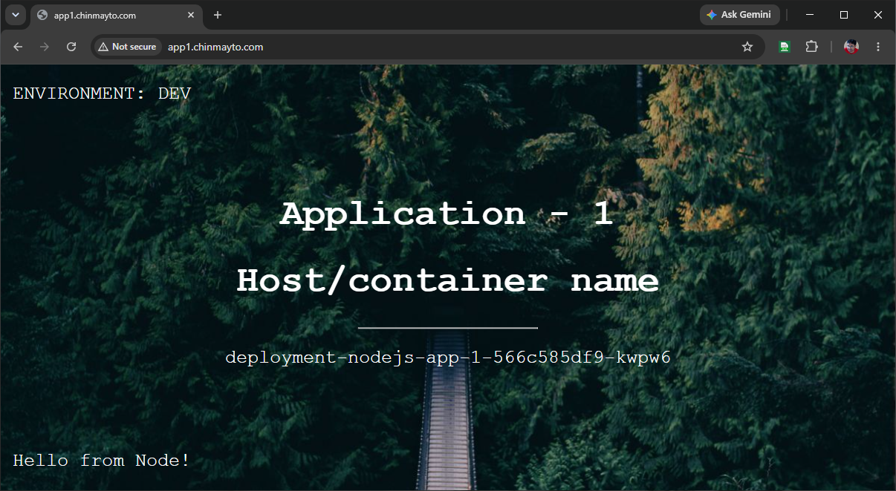
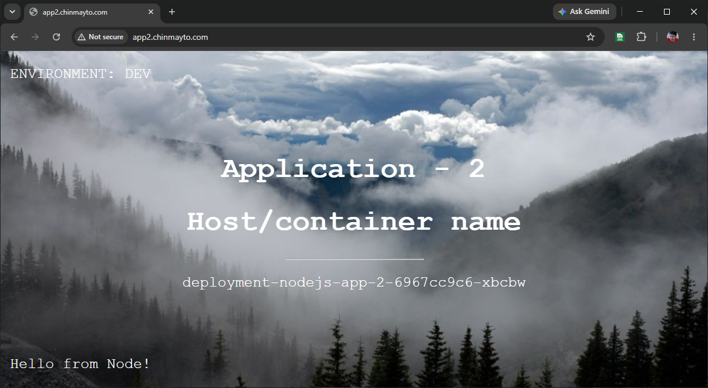
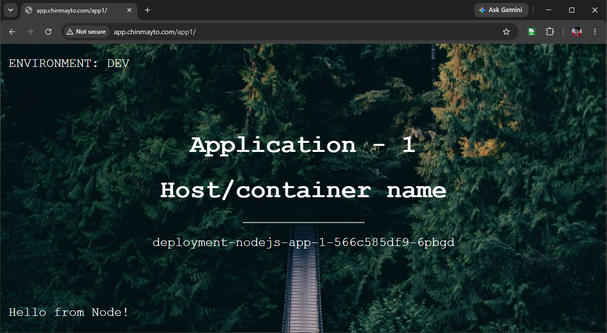
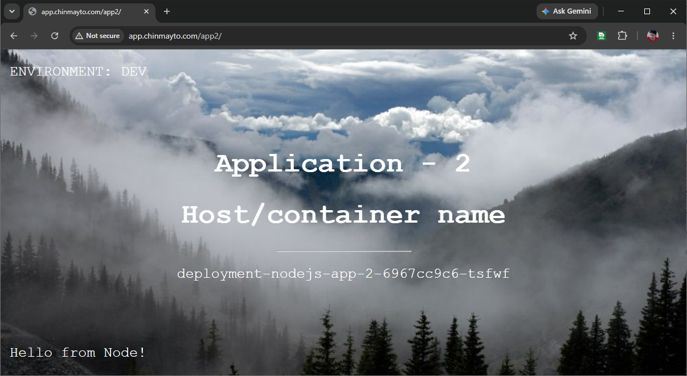

# Kubernetes Gateway API on Amazon EKS with Traefik — A Complete Guide

---

## Introduction

If you've been running Kubernetes workloads in production, you've almost certainly used an Ingress controller — probably nginx. It's been the de facto standard for routing external HTTP traffic into a cluster for years. But that era is coming to an end.

The nginx Ingress controller has announced **end of active support**, and the Kubernetes community has responded with a better answer: the **Gateway API**. In this post we'll walk through what Gateway API is, why it matters, how different controllers implement it, and how to deploy a real Node.js application on Amazon EKS using **Traefik** as the Gateway controller — all provisioned with Terraform.

---

## What Is the Kubernetes Gateway API?

The [Gateway API](https://gateway-api.sigs.k8s.io/) is a collection of official Kubernetes CRDs (Custom Resource Definitions) designed to replace the `Ingress` resource. It graduated to **GA (v1.0)** in October 2023 and has been steadily growing in adoption since.

Where `Ingress` is a single flat resource with limited expressiveness, Gateway API introduces a layered model with clear separation of concerns:

| Resource | Owned by | Purpose |
|---|---|---|
| `GatewayClass` | Cluster operator | Defines which controller manages Gateways |
| `Gateway` | Cluster operator | Configures the actual listener (port, protocol, TLS) |
| `HTTPRoute` | Application team | Defines routing rules to backend Services |
| `TCPRoute`, `TLSRoute`, `GRPCRoute` | Application team | Protocol-specific routing |

This separation matters in real organizations. Platform teams control the `Gateway` (and therefore what load balancer gets provisioned), while application teams deploy `HTTPRoutes` into their own namespaces without needing cluster-wide permissions. That's something the old `Ingress` spec could never cleanly express.

### Why Move Away from nginx Ingress?

The [Ingress-nginx](https://github.com/kubernetes/ingress-nginx) project — the community-maintained nginx Ingress controller — announced it is entering **maintenance-only mode**. New features will not be added, and the recommendation from the Kubernetes SIG-Network team is to migrate to Gateway API. The writing has been on the wall for a while: Ingress is a frozen API spec, and the ecosystem has moved on.

If you're starting a new project today, Gateway API is the right choice. If you have existing Ingress resources, now is the time to plan the migration.

---

## How Gateway API Controllers Work

Gateway API itself is just a specification — a set of CRDs. The actual work of provisioning load balancers and routing traffic is done by a **Gateway controller**. Any controller can implement the spec; they just need to watch for `GatewayClass` resources that advertise their `controllerName`.

Some popular implementations:

| Controller | `controllerName` | Notes |
|---|---|---|
| **Traefik** | `traefik.io/gateway-controller` | Cloud-native, fast, excellent DX |
| **Envoy Gateway** | `gateway.envoyproxy.io/gatewayclass-controller` | CNCF project, powerful |
| **Istio** | `istio.io/gateway-controller` | Service mesh with Gateway API |
| **Cilium** | `io.cilium/gateway-controller` | eBPF-based, very high performance |
| **AWS LBC** | `eks.amazonaws.com/load-balancer-controller` | AWS-native NLB/ALB provisioning |
| **nginx** | `k8s.nginx.org/nginxgateway` | NGINX Gateway Fabric (new project) |

The key insight: **the controller is pluggable**. Your `HTTPRoute` and `Gateway` manifests stay the same regardless of which controller you choose. You only change the `GatewayClass`.

### Why Traefik?

For this walkthrough we chose Traefik because:

- It's battle-tested in production and has first-class Gateway API support
- It installs via a single Helm chart with no IAM roles or AWS-specific setup
- It creates its own `Service` of type `LoadBalancer`, letting the AWS cloud-controller-manager provision the NLB automatically — no AWS Load Balancer Controller needed
- The Traefik dashboard gives you live routing visibility out of the box

---

## Architecture

Here's what we're building:

```
Internet
    │
    ▼
Route53 A-alias records (app / app1 / app2 .chinmayto.com)
    │   all three aliased to the SAME NLB hostname
    ▼
AWS Network Load Balancer          ← ONE NLB, provisioned automatically by EKS
    │                                 when Traefik Service type=LoadBalancer
    ▼
Traefik Pod (Deployment, 2 replicas, namespace: traefik)
    │   GatewayClass: traefik
    │   Gateway: traefik (namespace: traefik, listener "web" on port 80)
    ▼
HTTPRoute(s) + apps (one isolated namespace per part)
    │   Part_01 → namespace nodejs-app-part1
    │   Part_02 → namespace nodejs-app-part2
    │   Routing differs per part (see "Routing Patterns" below):
    │     Part_01 → by hostname   (app1 / app2)
    │     Part_02 → by path + URL rewrite (/app1/*, /app2/*)
    ▼
ClusterIP Services → Node.js Pods
    service-nodejs-app-1 (port 80 → container 8080)
    service-nodejs-app-2 (port 80 → container 8081)
```

> **Only one NLB is created.** All routing patterns and both apps sit behind the
> single Traefik `LoadBalancer` Service. The `app`, `app1`, and `app2` Route53
> records all alias to that one NLB; traffic is differentiated inside the cluster
> at the Gateway/HTTPRoute layer, not at the load balancer.

**Infrastructure components (all Terraform-managed):**

- **VPC** — two public + two private subnets across two AZs, single NAT gateway
- **EKS cluster** — managed node group, `t3.medium`, AL2023, Kubernetes 1.36
- **EKS Addons** — `vpc-cni`, `kube-proxy`, `coredns`, `eks-pod-identity-agent`
- **Gateway API CRDs** — installed via `kubectl apply` from the official v1.2.0 release
- **Traefik** — installed via Helm chart v33.x, Gateway API provider enabled
- **Route53 A record** — Terraform reads the NLB hostname from the Traefik Service and creates the alias record automatically

**No AWS Load Balancer Controller. No IRSA. No separate IAM policy.** Traefik handles the gateway layer; AWS cloud-controller-manager handles the NLB provisioning.

---

## Routing Patterns

This repo ships two Node.js apps and demonstrates two common Gateway API routing
patterns. Each pattern lives in its own folder under `k8s-manifests/` and is
self-contained — it includes both app deployments plus the HTTPRoute(s) specific
to that pattern, deployed into **its own dedicated namespace** so the parts are
fully isolated from one another and can coexist on the same cluster/NLB.

| | Pattern | Folder | Namespace | Entry URL(s) | Backend |
|---|---|---|---|---|---|
| **Part 01** | Hostname-Based Routing | `k8s-manifests/Part_01` | `nodejs-app-part1` | `app1.chinmayto.com`, `app2.chinmayto.com` | app-1 / app-2 by Host header |
| **Part 02** | URL Rewriting | `k8s-manifests/Part_02` | `nodejs-app-part2` | `app.chinmayto.com/app1/*`, `app.chinmayto.com/app2/*` | app-1 / app-2, prefix stripped |

Both parts target the **same Traefik Gateway** — the one auto-created by the
Helm chart. The HTTPRoutes attach to it via:

```yaml
parentRefs:
  - name: traefik        # Gateway auto-created by the Traefik Helm chart
    namespace: traefik   # Traefik deploys it into its own namespace
    sectionName: web     # the named "web" listener (port 80)
```

### Part 01 — Hostname-Based Routing

Two HTTPRoutes, each matching a distinct hostname. The request `Host` header
decides which backend serves it. Uses the `app1`/`app2` Route53 subdomains.

```yaml
# app1.chinmayto.com -> service-nodejs-app-1
hostnames: ["app1.chinmayto.com"]
rules:
  - matches:
      - path: { type: PathPrefix, value: / }
    backendRefs:
      - { name: service-nodejs-app-1, port: 80 }
---
# app2.chinmayto.com -> service-nodejs-app-2
hostnames: ["app2.chinmayto.com"]
rules:
  - matches:
      - path: { type: PathPrefix, value: / }
    backendRefs:
      - { name: service-nodejs-app-2, port: 80 }
```

### Part 02 — URL Rewriting

One HTTPRoute on a single hostname matching a path **prefix**, with a `URLRewrite`
filter that strips the prefix before forwarding. The backend only ever sees `/`,
so apps that know nothing about the sub-path keep working behind it. (This replaces
a naive exact-path approach, where the backend would receive `/app1` unchanged and
return `Cannot GET /app1` because it only serves `/`.)

```yaml
hostnames: ["app.chinmayto.com"]
rules:
  - matches:
      - path: { type: PathPrefix, value: /app1 }
    filters:
      - type: URLRewrite
        urlRewrite:
          path: { type: ReplacePrefixMatch, replacePrefixMatch: / }
    backendRefs:
      - { name: service-nodejs-app-1, port: 80 }
  - matches:
      - path: { type: PathPrefix, value: /app2 }
    filters:
      - type: URLRewrite
        urlRewrite:
          path: { type: ReplacePrefixMatch, replacePrefixMatch: / }
    backendRefs:
      - { name: service-nodejs-app-2, port: 80 }
```

---

## Step-by-Step Deployment

### 1. Deploy Infrastructure

```bash
terraform plan
terraform apply
```

This single `apply` does everything:
- Creates the VPC, subnets, NAT gateway
- Provisions the EKS cluster and node group
- Installs EKS addons
- Installs Gateway API CRDs (v1.2.0)
- Installs Traefik via Helm (with `enableGatewayAPI: true`)
- Waits 90 seconds for the NLB to be provisioned by AWS
- Reads the NLB hostname from the Traefik Service
- Creates the Route53 A-alias record

At the end of apply you'll see:

```
Outputs:

nodejs_app_dns_info = {
  "app_url"        = "http://app.chinmayto.com"
  "app1_hostname"  = "app1.chinmayto.com"
  "app1_url"       = "http://app1.chinmayto.com"
  "app2_hostname"  = "app2.chinmayto.com"
  "app2_url"       = "http://app2.chinmayto.com"
  "full_hostname"  = "app.chinmayto.com"
  "hosted_zone_id" = "Z0XXXXXXXXXXXXXXXXX"
  "nlb_hostname"   = "xxxx.elb.us-east-1.amazonaws.com"
  "subdomain"      = "app"
  "domain_name"    = "chinmayto.com"
}
```

Terraform creates **three** Route53 A-alias records (`app`, `app1`, `app2`), all
pointing at the single Traefik NLB. Which hostnames/paths actually route depends
on which part's manifests you apply next.

### 2. Deploy Kubernetes Manifests

```bash
# Update kubeconfig (Terraform does this automatically, but run it if needed)
aws eks --region us-east-1 update-kubeconfig --name CT-EKS-Cluster

# Pick ONE routing part and apply everything in its folder.
# Each folder contains both app deployments plus its HTTPRoute(s).

# Part 01 — Hostname-Based Routing
kubectl apply -f k8s-manifests/Part_01/

# Part 02 — URL Rewriting
kubectl apply -f k8s-manifests/Part_02/
```

> Each part deploys into its own namespace (`nodejs-app-part1` / `nodejs-app-part2`),
> so applying a part never touches the other part's resources. Part_01 uses distinct
> hostnames (`app1`/`app2`) and Part_02 uses `app`, so the two can run side by side
> without clashing. To fully remove a part, delete its namespace:
> `kubectl delete namespace nodejs-app-part2`.

### 4. Verify

```bash
# Traefik pod running?
kubectl get pods -n traefik

# GatewayClass accepted?
kubectl get gatewayclass traefik

# Gateway ready? (auto-created by the Traefik Helm chart in the traefik namespace)
kubectl get gateway traefik -n traefik

# HTTPRoute(s) accepted? (use the namespace for the part you deployed)
kubectl get httproute -n nodejs-app-part1   # or -part2
# ...or across all namespaces:
kubectl get httproute -A
```

```
# Application responding? (use the URL(s) for the part you deployed)

# Part 01 — Hostname-Based Routing
curl http://app1.chinmayto.com
curl http://app2.chinmayto.com
```




```
# Part 02 — URL Rewriting (note the trailing slash; the /app1 prefix is stripped)
curl http://app.chinmayto.com/app1/
curl http://app.chinmayto.com/app2/
```




### Key Terraform Resources

**Traefik Helm release (`gateway-api.tf`)**

```hcl
resource "helm_release" "traefik" {
  name       = "traefik"
  repository = "https://traefik.github.io/charts"
  chart      = "traefik"
  namespace  = kubernetes_namespace_v1.traefik.metadata[0].name
  version    = "33.2.1"

  values = [yamlencode({
    providers = {
      kubernetesGateway = { enabled = true }
      kubernetesIngress = { enabled = false }
    }
    service = {
      type = "LoadBalancer"
      annotations = {
        "service.beta.kubernetes.io/aws-load-balancer-type"   = "nlb"
        "service.beta.kubernetes.io/aws-load-balancer-scheme" = "internet-facing"
      }
    }
    gateway = {
      enabled = true
      name    = "traefik"
    }
  })]
}
```

**Route53 record from Traefik Service (`app-dns.tf`)**

```hcl
resource "time_sleep" "wait_for_nlb" {
  create_duration = "90s"
  depends_on      = [helm_release.traefik]
}

data "kubernetes_service_v1" "traefik" {
  metadata {
    name      = "traefik"
    namespace = "traefik"
  }
  depends_on = [time_sleep.wait_for_nlb]
}

# app.<domain>  — used by Part_02 (URL rewrite)
resource "aws_route53_record" "nodejs_app" {
  zone_id = data.aws_route53_zone.main.zone_id
  name    = "${var.app_subdomain}.${var.domain_name}"
  type    = "A"

  alias {
    name                   = data.kubernetes_service_v1.traefik.status[0].load_balancer[0].ingress[0].hostname
    zone_id                = local.nlb_hosted_zone_id
    evaluate_target_health = true
  }
}

# app1.<domain> / app2.<domain> — used by Part_01 (hostname-based routing).
# Both alias to the SAME NLB; the HTTPRoute hostnames do the differentiation.
resource "aws_route53_record" "nodejs_app_1" {
  zone_id = data.aws_route53_zone.main.zone_id
  name    = "${var.app1_subdomain}.${var.domain_name}"
  type    = "A"

  alias {
    name                   = data.kubernetes_service_v1.traefik.status[0].load_balancer[0].ingress[0].hostname
    zone_id                = local.nlb_hosted_zone_id
    evaluate_target_health = true
  }
}

resource "aws_route53_record" "nodejs_app_2" {
  zone_id = data.aws_route53_zone.main.zone_id
  name    = "${var.app2_subdomain}.${var.domain_name}"
  type    = "A"

  alias {
    name                   = data.kubernetes_service_v1.traefik.status[0].load_balancer[0].ingress[0].hostname
    zone_id                = local.nlb_hosted_zone_id
    evaluate_target_health = true
  }
}
```

**Gateway (auto-created by the Traefik Helm chart)**

There's no hand-written Gateway manifest. The Traefik chart (`gateway.enabled = true`)
creates a `Gateway` named `traefik` in the `traefik` namespace with a `web` listener
on port 80. Every HTTPRoute attaches to it via `parentRefs`:

```yaml
parentRefs:
  - name: traefik
    namespace: traefik
    sectionName: web
```

**HTTPRoute manifest — Part 01 example (`Part_01/gateway-api-nodejs-app.yaml`)**

```yaml
apiVersion: gateway.networking.k8s.io/v1
kind: HTTPRoute
metadata:
  name: nodejs-app-1-httproute
  namespace: nodejs-app-part1
spec:
  parentRefs:
    - name: traefik
      namespace: traefik
      sectionName: web
  hostnames:
    - "app1.chinmayto.com"
  rules:
    - matches:
        - path:
            type: PathPrefix
            value: /
      backendRefs:
        - name: service-nodejs-app-1
          port: 80
```

See the [Routing Patterns](#routing-patterns) section for the Part 02 (URL rewrite)
variant.

---

## Cleanup

To tear everything down cleanly — delete the Kubernetes resources first so the NLB is deprovisioned before Terraform tries to destroy the VPC.

```bash
# 1. Delete the Kubernetes resources for whichever part(s) you deployed.
#    Deleting a part's folder removes its Namespace, HTTPRoutes, Deployments
#    and Services in one go.
kubectl delete -f k8s-manifests/Part_01/

kubectl delete -f k8s-manifests/Part_02/

# 2. Wait ~60 seconds for the NLB to be fully removed by AWS
sleep 60

# 3. Destroy all Terraform-managed infrastructure
cd infrastructure
terraform destroy
```

> **Why the order matters**: If you run `terraform destroy` while the Traefik LoadBalancer Service still exists, AWS will not delete the NLB (it's owned by Kubernetes). The NLB's ENIs will still be attached to the VPC subnets, and Terraform will fail trying to delete the VPC with a dependency error. Always drain the k8s resources first.

---

## Conclusion

The Kubernetes Gateway API is a genuine step forward from the Ingress spec. The separation between `GatewayClass`, `Gateway`, and `HTTPRoute` maps cleanly onto how real platform and application teams work. The nginx Ingress controller served us well for years, but with active development winding down and Gateway API reaching GA, now is the right time to migrate.

Traefik makes this particularly straightforward on EKS — no IAM roles, no IRSA, no separate controller installation just to provision a load balancer. One Helm chart, one `helm_release` resource in Terraform, and you have a production-ready Gateway API implementation with an NLB and Route53 DNS fully automated.

The full deployment — VPC, EKS, Traefik, NLB, Route53 — is a single `terraform apply`. That's the kind of operational simplicity that makes a difference at scale.

---

## References

- **GitHub Repository**: [chinmayto/terraform-aws-eks-gateway-api](https://github.com/chinmayto/terraform-aws-eks-gateway-api)
- [Kubernetes Gateway API — Official Docs](https://gateway-api.sigs.k8s.io/)
- [Gateway API — Supported Features by Implementation](https://gateway-api.sigs.k8s.io/implementations/)
- [Traefik Gateway API Documentation](https://doc.traefik.io/traefik/routing/providers/kubernetes-gateway/)
